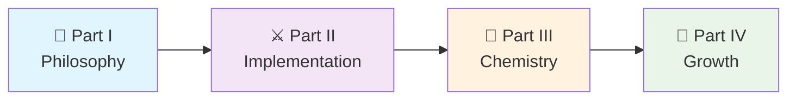
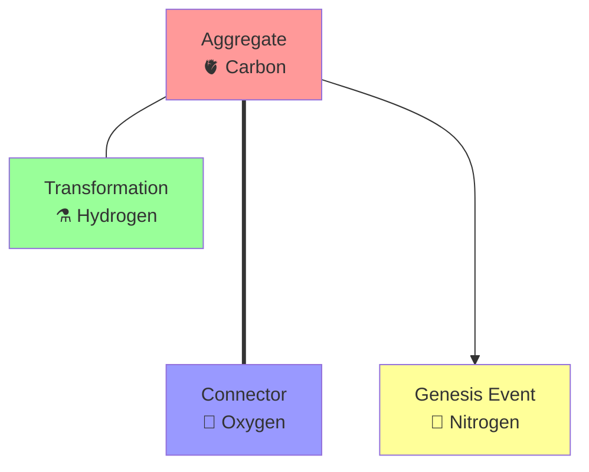

# 🏰 The Hive Architecture
## Your Journey into Nature-Inspired Software Design

```
           🐝 Welcome to the Enchanted Apiary 🐝
     
            "Just as chemistry's periodic table unlocked 
             modern science, the Hive's table will unlock 
             scalable, predictable software architecture."
                                                - Jules

    ┌─────────────────────────────────────────────────────────┐
    │  🌸 The Garden     │  🏰 The Hive     │  🧬 The Code   │
    │                    │                   │                │
    │  • Users           │  • Aggregates     │  • ATCG        │
    │  • External APIs   │  • Connectors     │  • Codons      │
    │  • Databases       │  • Transformations│  • Events      │
    │  • Services        │  • Genesis Events │  • Patterns    │
    └─────────────────────────────────────────────────────────┘
```

---

## 🗺️ Your Hive Architecture Adventure

Welcome, brave builder, to the most comprehensive guide for creating living, breathing software ecosystems! The Hive Architecture isn't just another framework—it's a revolutionary approach inspired by nature's most sophisticated organizational structure: the beehive.

### 🎯 Why This Journey Matters

- **🌱 Organic Growth**: A methodology for building systems that can evolve naturally.
- **🔬 Scientific Foundation**: An approach based on proven biological and chemical patterns.
- **💭 Conceptual Framework**: A way of thinking about architecture, not a ready-made solution.
- **🌍 Ecosystem Scale**: Concepts that apply from single features to global platforms.

---

## 🏛️ Структура этого репозитория

Этот репозиторий содержит два ключевых компонента:

1.  **`/docs`**: Основная документация, предназначенная для **людей**. Здесь вы найдете философию, паттерны и руководства по методологии Hive Architecture. Это лучшее место для начала, если вы хотите понять концепции.
2.  **`protocol.md`**: Техническая спецификация (или "системный промпт"), предназначенная для **AI-агента "Садовник"**. Этот файл описывает правила, метрики и поведение, которым должен следовать автоматизированный агент при работе с кодовой базой, построенной по принципам Hive.

---

## 🚀 Choose Your Adventure

### ⚡ Quick Start (5 minutes)
*"I need the essence now!"*

Jump straight to our **Sacred ATCG Code**:
- **A**ggregate - Your business logic organs
- **T**ransformation - Pure processing enzymes  
- **C**onnector - External world bridges
- **G**enesis Event - System memory and communication

**Start here:** [Sacred Codon Quick Reference](#quick-reference)

---

### 🎓 Learning Journey (30-60 minutes)
*"I want to understand the philosophy and patterns"*

Perfect for architects and senior developers who want deep understanding:



**Your Path:**
1. **[Part I: The Enchanted Apiary](docs/01_philosophy/hive_preprint_part1_enchanted_apiary.md)** (15 min) - 🌸 Core philosophy & fairy tale foundation
2. **[Part II: The Beekeeper's Grimoire](docs/02_atcg_genome/hive_preprint_part2_beekeeper_grimoire.md)** (20 min) - ⚔️ Technical implementation & Sacred Codons
3. **[Part III: The Chemical Architecture](docs/03_patterns/hive_preprint_part3_chemical_architecture.md)** (15 min) - 🧪 Advanced patterns & chemical bonds
4. **[Part IV: Growing Your Hive](docs/04_growth_and_scaling/hive_preprint_part4_growing_your_hive.md)** (20 min) - 🌱 Practical scaling & implementation

---
---

### 👔 Executive Summary (10 minutes)
*"What's the business value and ROI?"*

Jump to the results that matter:
- **[Growth Framework Overview](docs/04_growth_and_scaling/hive_preprint_part4_growing_your_hive.md#success-metrics-and-kpis)** - KPIs and business metrics
- **[Case Study: E-commerce Platform](docs/04_growth_and_scaling/hive_preprint_part4_growing_your_hive.md#real-world-ecosystem-case-study-global-e-commerce-platform)** - 3x productivity increase
- **[Implementation Roadmap](docs/04_growth_and_scaling/hive_preprint_part4_growing_your_hive.md#implementation-roadmap-templates)** - 30/90/365 day plans

---

## 🎪 Interactive Learning Paths

### 🏛️ The Architect's Path
*For system designers and technical architects*

**Focus**: Philosophy, patterns, and large-scale design
- [ ] Read [Part I: The Enchanted Apiary](docs/01_philosophy/hive_preprint_part1_enchanted_apiary.md) - Understand the bio/sci philosophy
- [ ] Study [Hexagonal to Hive mapping](docs/01_philosophy/hive_preprint_part1_enchanted_apiary.md#architectural-mapping-hexagonal-to-hive)
- [ ] Master [Chemical Architecture](docs/03_patterns/hive_preprint_part3_chemical_architecture.md) - Advanced system design
- [ ] Plan with [Ecosystem Patterns](docs/04_growth_and_scaling/hive_preprint_part4_growing_your_hive.md#ecosystem-architecture-patterns)

**Time Investment**: 60 minutes
**Outcome**: Complete architectural understanding

---

### 👑 The Team Lead's Path
*For engineering managers and team leads*

**Focus**: Adoption, scaling, and team transformation  
- [ ] Understand [Core Philosophy](docs/01_philosophy/hive_preprint_part1_enchanted_apiary.md) for team communication
- [ ] Review [Implementation Strategies](docs/04_growth_and_scaling/hive_preprint_part4_growing_your_hive.md#phase-2-colony-building)
- [ ] Study [Case Studies](docs/04_growth_and_scaling/hive_preprint_part4_growing_your_hive.md#colony-building-case-study-e-commerce-platform)
- [ ] Plan [Team Training](docs/04_growth_and_scaling/hive_preprint_part4_growing_your_hive.md#step-2-team-training-and-standards)

**Time Investment**: 45 minutes  
**Outcome**: Team transformation roadmap

---

### 🔬 The Innovator's Path
*For those pushing boundaries*

**Focus**: Advanced patterns and future possibilities
- [ ] Deep dive [Chemical Architecture](docs/03_patterns/hive_preprint_part3_chemical_architecture.md)
- [ ] Explore [Quantum Hive Patterns](docs/04_growth_and_scaling/hive_preprint_part4_growing_your_hive.md#quantum-hive-patterns)
- [ ] Study [Emergent Intelligence](docs/04_growth_and_scaling/hive_preprint_part4_growing_your_hive.md#emergent-intelligence)
- [ ] Contribute to [Cosmic Hive Vision](docs/04_growth_and_scaling/hive_preprint_part4_growing_your_hive.md#future-evolution-the-cosmic-hive)

**Time Investment**: 90 minutes
**Outcome**: Next-generation architecture insights

---

## 🧬 Quick Reference

### The Sacred ATCG Code

```python
# The Four Fundamental Primitives
class HiveDNA:
    A = "Aggregate"     # 🫀 Business logic organs
    T = "Transformation" # ⚗️ Pure processing enzymes  
    C = "Connector"     # 🌉 External world bridges
    G = "Genesis Event" # 📢 System memory & communication
```

### The Five Sacred Codons

| Pattern | Flow | Purpose | Example |
|---------|------|---------|---------|
| **C→A→G** | Connector → Aggregate → Genesis | Command Processing | REST API → Order → OrderPlaced |
| **C→T→C** | Connector → Transformation → Connector | Data Pipeline | DB → PriceCalc → Cache |
| **G→C→A→G** | Genesis → Connector → Aggregate → Genesis | Event Reaction | OrderPlaced → PaymentAPI → Payment → PaymentProcessed |
| **G→C→A→C** | Genesis → Connector → Aggregate → Connector | Event to Output | OrderPlaced → EmailAPI → Notification → EmailService |
| **Choreography** | Multiple Genesis Events | Complex Workflow | Order fulfillment across multiple hives |

### Chemical Bonds



---
---

## 🎯 Learning Progress Tracker

### Phase 1: Foundation Understanding
- [ ] Understand the beehive metaphor and why it matters
- [ ] Grasp the four ATCG primitives 
- [ ] Learn the Quaternary and Duality principles
- [ ] Map Hexagonal Architecture to Hive concepts

### Phase 2: Pattern Mastery
- [ ] Master the five Sacred Codon patterns
- [ ] Implement C→A→G command processing
- [ ] Build C→T→C data transformation pipelines
- [ ] Create Genesis Event choreography

### Phase 3: Chemical Architecture
- [ ] Understand software components as chemical elements
- [ ] Apply periodic table principles to system design
- [ ] Detect and resolve architectural toxicity
- [ ] Use chemical bond analysis for optimization

### Phase 4: Growth and Scaling
- [ ] Plan hive growth through the four phases
- [ ] Implement inter-hive communication
- [ ] Deploy ecosystem-wide patterns
- [ ] Enable emergent intelligence

---

## 🌟 Success Stories

### Real Results from Hive Adoption

> **MegaCommerce Inc.** - *18-month transformation*
> - 🚀 **3x increase** in feature delivery velocity
> - ⚡ **99.95% uptime** across all hives  
> - 😊 **92% developer satisfaction** with architecture
> - ⏱️ **60% reduction** in time-to-market

> **TechStartup Co.** - *6-month implementation*
> - 📈 **40% improvement** in system performance
> - 🧹 **75% reduction** in technical debt
> - 👥 **Zero cross-team coordination** meetings needed
> - 🎯 **100% Sacred Codon compliance** achieved

---

## 🚨 Need Help?

### Quick Support Options

**🆘 Stuck on Concepts?**
- Start with [The Enchanted Apiary](docs/hive_preprint_part1_enchanted_apiary.md) fairy tale
- Review [Quick Reference](#quick-reference) above

**🏢 Team Adoption Challenges?**
- Review [The Team Lead's Path](#-the-team-leads-path)
- Study [Colony Building Phase](docs/hive_preprint_part4_growing_your_hive.md#phase-2-colony-building)
- Use [Success Metrics](docs/hive_preprint_part4_growing_your_hive.md#success-metrics-and-kpis)

**🧪 Advanced Architecture Questions?**
- Explore [Chemical Architecture](docs/hive_preprint_part3_chemical_architecture.md)
- Try [Quantum Hive Patterns](docs/hive_preprint_part4_growing_your_hive.md#quantum-hive-patterns)

---

## 🌍 Join the Ecosystem

### Contributing to the Hive Methodology

The Hive Architecture is a living methodology that grows through community collaboration:

- **💡 Have a pattern idea?** Share it through GitHub issues or discussions.
- **🏢 Implemented concepts in your org?** We'd love to hear your story!
- **📚 Want to improve docs?** Documentation contributions are always welcome.

### Connect with Fellow Beekeepers

- **GitHub Discussions**: Share experiences and get help with the concepts.
- **Case Studies**: Document your Hive transformation journey and share it with the community.

---

## 🔮 What's Next?

### Emerging Developments

The Hive Architecture continues to evolve:

- **🤖 AI Beekeepers**: Automated system optimization
- **🌌 Cosmic Hives**: Inter-organizational collaboration patterns  
- **⚛️ Quantum Computing**: Next-generation processing paradigms
- **🧬 Genetic Programming**: Self-evolving code structures

### Your Evolution Journey

As you master the Hive Architecture, you'll naturally progress through these stages:

1. **🐝 Worker Bee** - Implementing Sacred Codon patterns
2. **🏗️ Architect Bee** - Designing hive ecosystems  
3. **🧪 Chemist Bee** - Optimizing chemical architectures
4. **🤖 AI Beekeeper** - Creating emergent intelligence
5. **🌌 Cosmic Beekeeper** - Building inter-organizational ecosystems

---

## ✨ Ready to Begin?

```
🎉 Welcome to the most exciting architectural adventure of your career!

    Choose your path above and let the transformation begin.
    
    Remember: The best code is not written—it is grown.

                    🐝 Happy coding, fellow Beekeeper! 🐝
```

---

*"In the end, we are all beekeepers, tending our digital hives with patience, wisdom, and love. For it is only through such care that our systems can truly thrive and serve the greater good."* 

— The Beekeeper's Final Wisdom

---

### 📚 Table of Contents

1. **[Part I: The Enchanted Apiary](docs/hive_preprint_part1_enchanted_apiary.md)** - Core philosophy and fairy tale foundation
2. **[Part II: The Beekeeper's Grimoire](docs/hive_preprint_part2_beekeeper_grimoire.md)** - Technical implementation with Sacred Codons
3. **[Part III: The Chemical Architecture](docs/hive_preprint_part3_chemical_architecture.md)** - Advanced patterns using chemical analogies
4. **[Part IV: Growing Your Hive](docs/hive_preprint_part4_growing_your_hive.md)** - Practical scaling and implementation roadmap
